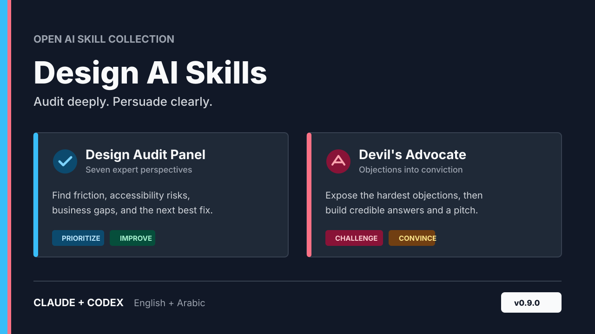

# Design AI Skills by Faris




Two focused AI skills for people who design, present, and defend ideas. Use them with **Claude**, **Codex**, Claude Code, Figma-oriented agents, or any assistant that loads `SKILL.md` files. English and Arabic are supported, with no coding required.

[English](#english) | [العربية](#العربية) | [Version 0.9.1](CHANGELOG.md#091---2026-09-02)

---

## English

### What kind of skills are these?

This is a small, opinionated toolkit rather than a large catalog:

- **Evaluative**: `design-audit-panel` reviews existing design evidence and returns prioritized findings.
- **Decision support**: `devils-advocate-and-convincer` tests an idea, then turns defensible responses into a pitch.

Choose the first when something needs inspection. Choose the second when a decision or proposal needs pressure-testing.

### Quick start

For the easiest installation, copy the [one-prompt installer](INSTALL.md) into an AI agent that can browse the web and write files. It asks which skill you want, fetches only the required files, and installs them into the agent's supported skills directory without a ZIP or full repository download. Each folder is independently usable and must keep its `SKILL.md`, `agents/openai.yaml`, and any `references` together.

### Choose a skill

| Skill | Best for | What you receive |
| --- | --- | --- |
| [`design-audit-panel`](design-audit-panel/) | Reviewing a screen, flow, product concept, or feature before building or shipping | An executive summary and prioritized reports from up to seven expert perspectives |
| [`devils-advocate-and-convincer`](devils-advocate-and-convincer/) | Pressure-testing an idea before a pitch, proposal, negotiation, or difficult conversation | Specific objections, persuasive responses, and a presentation-ready narrative |

### Install

#### One-prompt installation (recommended)

1. Open [`INSTALL.md`](INSTALL.md).
2. Copy the prompt for your language into your AI agent.
3. Choose `design-audit-panel`, `devils-advocate-and-convincer`, or both when the agent asks.
4. Confirm the skills directory before the agent writes files.

The agent must have web access and permission to create or update files. A prompt cannot bypass those permissions. If the agent is chat-only, it may use the skill for the current conversation but cannot install it persistently.

#### Provider-specific installation

Use the guidance below when your provider has a documented skills or plugin workflow. The portable folder method remains available when the one-prompt installer cannot access files.

#### Portable installation

- **Any `SKILL.md` consumer**: copy `design-audit-panel/` or `devils-advocate-and-convincer/` into its skills directory.
- **Claude Code, Cursor, Codex, and compatible agents**: from the repository root, try `npx skills add . --list`, then install the selected skill or the full collection according to that tool's prompt.
- **Claude Code plugin-compatible clients**: use the repository as a local plugin source when your client supports `.claude-plugin/plugin.json`; otherwise use the portable folder installation above.
- **Figma-oriented agents**: provide a Figma link only when a connected Figma capability can inspect it. Otherwise attach screenshots or an exported description.

#### Claude

1. In **Settings > Capabilities**, enable **Code execution and file creation**. Team or Enterprise owners may need to enable Skills in the organization settings.
2. Compress the complete skill folder as a ZIP file. Keep `SKILL.md` and any `references` folder together.
3. Open **Customize > Skills**, select **+ > Create skill > Upload a skill**, and upload the ZIP file.
4. Make sure the skill is enabled, then name it in your request or describe the task naturally.

See Anthropic's current [custom skill instructions](https://support.claude.com/en/articles/12512180-use-skills-in-claude) for plan and organization details.

#### Codex

1. Copy each complete skill folder into `.agents/skills/` inside a repository for project use, or into `$HOME/.agents/skills/` for personal use everywhere.
2. Start or restart Codex if the new skill does not appear automatically.
3. Type `$design-audit-panel` or `$devils-advocate-and-convincer` in your prompt. You can also run `/skills` in Codex CLI or the IDE extension to find installed skills.

The Codex paths and invocation syntax follow the current [official OpenAI skill guidance](https://developers.openai.com/codex/skills/).

### Try it

**Design audit**

```text
$design-audit-panel
Audit this checkout flow for first-time mobile shoppers: [attach screenshots or add a Figma link].
Use the Frustrated User, Accessibility, and UI/UX perspectives.
Return the result in Markdown.
```

Expected output: a cross-perspective summary, ranked issues, a consolidated action plan, and one structured report per selected perspective.

**Devil's Advocate + Convincer**

```text
$devils-advocate-and-convincer
Name: Four-day design sprint
What: Replace our current five-day workshop with a focused four-day format.
Why: Reduce stakeholder fatigue while preserving decision quality.
Audience: A skeptical product director.
```

Expected output: realistic objections grouped by risk, a direct response to each objection, and a 200-400 word pitch ready to present.

### Compatibility and behavior

- Both skills follow the language of your request unless you ask for another language.
- Markdown works everywhere and is the default when file-generation tools are unavailable.
- Word, PDF, Figma, and image handling depend on the tools connected to your Claude or Codex environment.
- When a linked design cannot be opened, the skill asks for screenshots or a short description instead of pretending it saw the design.
- The repository includes optional package metadata for clients that support Claude-style local plugins; portable skill-folder installation remains the fallback.
- The collection uses one shared version number. The current release is **v0.9.1**.

### Troubleshooting

| Problem | What to do |
| --- | --- |
| The skill is not listed | Confirm the complete folder was installed and that `SKILL.md` is directly inside it, then restart the app. |
| A Figma link cannot be read | Connect a Figma tool if your environment supports one, or attach exported screenshots. |
| Word or PDF is unavailable | Ask for Markdown; the report content remains the same. |
| The result is too long on mobile | Ask for a compact layout or fewer expert perspectives. |
| The skill responds in the wrong language | Say `Answer in English` or `أجب بالعربية` in the request. |

---

## العربية

### ما نوع هذه المهارات؟

هذه مجموعة صغيرة ومحددة وليست دليلاً ضخماً:

- **تقييمية**: تراجع `design-audit-panel` أدلة التصميم وتعيد نتائج مرتبة حسب الأولوية.
- **دعم القرار**: تختبر `devils-advocate-and-convincer` الفكرة، ثم تحول الردود القابلة للدفاع إلى خطاب مقنع.

اختر الأولى عندما تحتاج إلى فحص شيء موجود، والثانية عندما تحتاج إلى اختبار قرار أو مقترح قبل عرضه.

### البدء السريع

لأسهل تثبيت، انسخ [أمر التثبيت بأمر واحد](INSTALL.md) إلى وكيل ذكاء اصطناعي يستطيع تصفح الويب وكتابة الملفات. سيسألك عن المهارة المطلوبة، ويجلب الملفات اللازمة فقط، ويثبتها في مجلد المهارات الذي يدعمه الوكيل من دون ملف ZIP أو تنزيل المستودع كاملاً. كل مجلد مستقل ويجب أن يحتفظ بملفات `SKILL.md` و`agents/openai.yaml` ومجلد `references` إن وجد.

مهارتان جاهزتان للاستخدام مع أدوات الذكاء الاصطناعي للمصممين وكل من يراجع الأفكار أو يقدمها أو يدافع عنها. تعملان مع **Claude** و**Codex** بالعربية أو الإنجليزية، ولا تحتاجان إلى خبرة برمجية.

### اختر المهارة المناسبة

| المهارة | مناسبة لـ | النتيجة التي تحصل عليها |
| --- | --- | --- |
| [`design-audit-panel`](design-audit-panel/) | مراجعة شاشة أو رحلة مستخدم أو فكرة منتج أو ميزة قبل تنفيذها أو إطلاقها | ملخص تنفيذي وتقارير مرتبة حسب الأولوية من سبع وجهات نظر متخصصة كحد أقصى |
| [`devils-advocate-and-convincer`](devils-advocate-and-convincer/) | اختبار الفكرة قبل عرض أو اقتراح أو تفاوض أو محادثة صعبة | اعتراضات واقعية وردود مقنعة وخطاب جاهز للتقديم |

### التثبيت

#### التثبيت بأمر واحد (موصى به)

1. افتح [`INSTALL.md`](INSTALL.md).
2. انسخ الأمر بلغتك إلى وكيل الذكاء الاصطناعي.
3. اختر `design-audit-panel` أو `devils-advocate-and-convincer` أو المهارتين عندما يسألك الوكيل.
4. أكّد مجلد المهارات قبل أن يكتب الوكيل الملفات.

يحتاج الوكيل إلى الوصول إلى الويب وإذن إنشاء الملفات أو تحديثها. لا يمكن لأمر واحد تجاوز هذه الأذونات. إذا كان الوكيل نصياً فقط، فقد يستخدم المهارة في المحادثة الحالية لكنه لا يستطيع تثبيتها بشكل دائم.

#### التثبيت الخاص بمقدم الخدمة

استخدم الإرشادات التالية عندما يوفر مقدم الخدمة طريقة موثقة للمهارات أو الإضافات. وتبقى طريقة نسخ مجلد المهارة متاحة عندما لا يستطيع أمر التثبيت بأمر واحد الوصول إلى الملفات.

#### التثبيت المحمول

- **أي أداة تدعم `SKILL.md`**: انسخ `design-audit-panel/` أو `devils-advocate-and-convincer/` إلى مجلد المهارات.
- **Claude Code وCursor وCodex والأدوات المتوافقة**: من جذر المستودع جرّب `npx skills add . --list`، ثم ثبّت المهارة المطلوبة أو المجموعة كاملة وفقاً للأداة.
- **العملاء الذين يدعمون إضافات Claude**: استخدم المستودع كمصدر إضافة محلي عندما يدعم العميل `.claude-plugin/plugin.json`، وإلا استخدم التثبيت المحمول للمجلد.
- **الأدوات المتصلة بـFigma**: أرسل رابط Figma فقط عندما تتوفر قدرة متصلة لقراءته. وإلا أرفق لقطات شاشة أو وصفاً مصدراً.

#### Claude

1. فعّل **Code execution and file creation** من **Settings > Capabilities**. قد يحتاج مالك حساب Team أو Enterprise إلى تفعيل Skills من إعدادات المؤسسة.
2. اضغط مجلد المهارة كاملاً في ملف ZIP، مع إبقاء `SKILL.md` ومجلد `references` إن وجد معاً.
3. افتح **Customize > Skills**، ثم اختر **+ > Create skill > Upload a skill** وارفع ملف ZIP.
4. تأكد من تفعيل المهارة، ثم اذكر اسمها في طلبك أو اشرح المهمة بطريقة طبيعية.

راجع [تعليمات Anthropic الرسمية](https://support.claude.com/en/articles/12512180-use-skills-in-claude) لمعرفة تفاصيل الخطط وحسابات المؤسسات.

#### Codex

1. انسخ مجلد كل مهارة كاملاً إلى `.agents/skills/` داخل المستودع لاستخدامها في مشروع محدد، أو إلى `$HOME/.agents/skills/` لاستخدامها في كل مشاريعك.
2. أعد تشغيل Codex إذا لم تظهر المهارة تلقائياً.
3. اكتب `$design-audit-panel` أو `$devils-advocate-and-convincer` في طلبك. ويمكنك استخدام `/skills` في Codex CLI أو إضافة IDE للعثور على المهارات المثبتة.

### جرّب المهارات

**تدقيق التصميم**

```text
$design-audit-panel
راجع رحلة الدفع هذه لمستخدم يشتري من الهاتف لأول مرة: [أرفق الصور أو رابط Figma].
استخدم وجهات نظر المستخدم المحبط وخبير الوصول وخبير UI/UX.
أعد النتيجة بصيغة Markdown.
```

النتيجة المتوقعة: ملخص مشترك، مشكلات مرتبة حسب الأولوية، خطة عمل موحدة، وتقرير منظم لكل وجهة نظر اخترتها.

**محامي الشيطان + الإقناع**

```text
$devils-advocate-and-convincer
الاسم: ورشة تصميم من أربعة أيام
الفكرة: استبدال ورشة الأيام الخمسة الحالية بصيغة مركزة من أربعة أيام.
السبب: تقليل إرهاق أصحاب المصلحة مع الحفاظ على جودة القرارات.
الجمهور: مدير منتج متشكك.
```

النتيجة المتوقعة: اعتراضات واقعية مصنفة حسب المخاطر، رد مباشر على كل اعتراض، وخطاب من 200 إلى 400 كلمة جاهز للتقديم.

### التوافق والسلوك

- تتبع المهارتان لغة طلبك ما لم تطلب لغة أخرى.
- تعمل صيغة Markdown في كل البيئات، وهي البديل الافتراضي عندما لا تتوفر أدوات إنشاء الملفات.
- يعتمد إنشاء Word أو PDF وفتح Figma والصور على الأدوات المتصلة ببيئة Claude أو Codex لديك.
- إذا تعذر فتح رابط التصميم، تطلب المهارة صوراً أو وصفاً مختصراً بدلاً من ادعاء أنها شاهدت التصميم.
- يتضمن المستودع بيانات اختيارية للعملاء الذين يدعمون إضافات Claude المحلية، ويبقى تثبيت مجلد المهارة هو البديل المحمول.
- تستخدم المجموعة رقم إصدار واحداً مشتركاً. الإصدار الحالي هو **v0.9.1**.

### حل المشكلات

| المشكلة | الحل |
| --- | --- |
| المهارة لا تظهر | تأكد من تثبيت المجلد كاملاً ومن وجود `SKILL.md` داخله مباشرة، ثم أعد تشغيل التطبيق. |
| لا يمكن قراءة رابط Figma | اربط أداة Figma إذا كانت بيئتك تدعمها، أو أرفق صوراً مصدرة. |
| Word أو PDF غير متاح | اطلب Markdown؛ سيبقى محتوى التقرير نفسه. |
| النتيجة طويلة على الهاتف | اطلب تنسيقاً مختصراً أو عدداً أقل من وجهات النظر. |
| لغة الإجابة غير صحيحة | أضف `أجب بالعربية` أو `Answer in English` إلى طلبك. |

---

## Versioning / الإصدارات

This repository follows [Semantic Versioning](https://semver.org/):

- **Patch / تصحيح** (`0.9.1`): fixes and wording improvements that preserve behavior.
- **Minor / فرعي** (`0.10.0`): new compatible capabilities or skills.
- **Major / رئيسي** (`1.0.0`, then `2.0.0`): stable milestones or breaking behavior changes.

Release notes live in [`CHANGELOG.md`](CHANGELOG.md), and the current machine-readable version lives in [`VERSION`](VERSION).

## Contributing / المساهمة

See [`CONTRIBUTING.md`](CONTRIBUTING.md) for the quality bar, focused change guidance, bilingual expectations, and validation command.

## License / الترخيص

[CC BY 4.0](LICENSE) - use, remix, and share with credit to Ahmed Faris (فارس المجرة).

Built and shared by [Ahmed Faris](https://afaris.me) - فارس المجرة.
